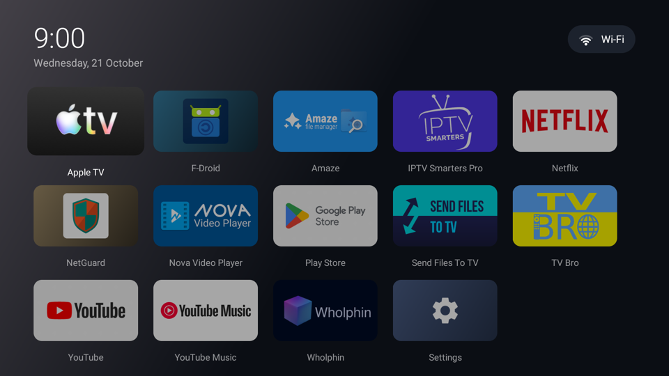
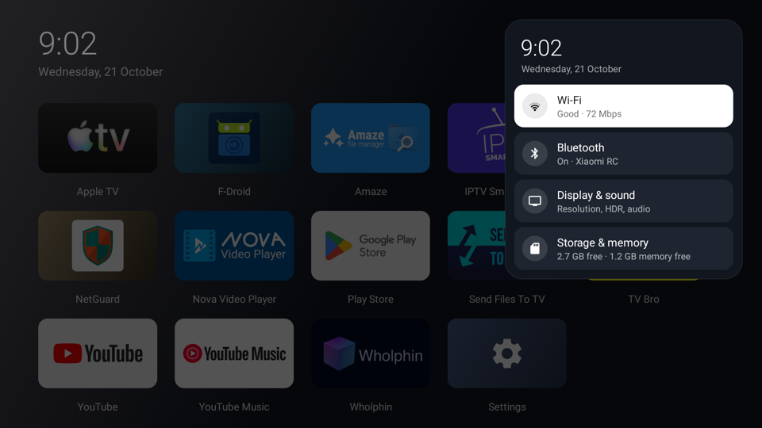
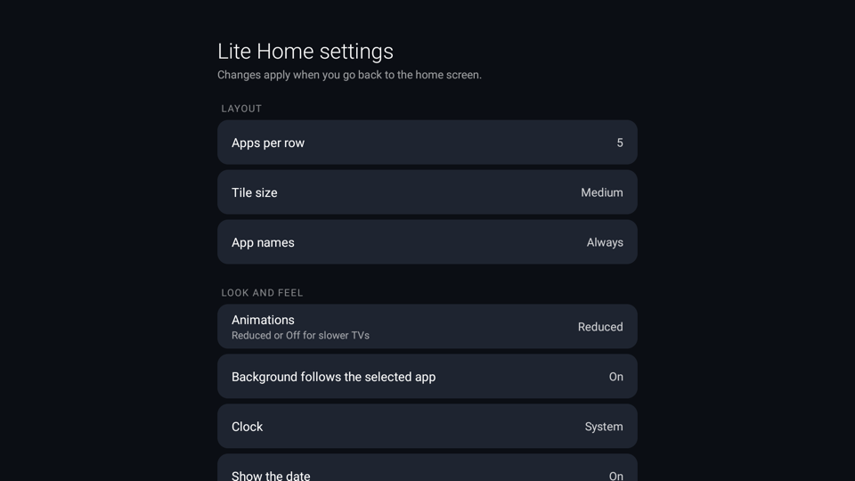

# The A–Z guide

Every step, in order, from a stock Xiaomi TV box, stick or TV to a debloated device with the
Lite Home launcher. ("Box" below means whichever device you have.)
Each step says what it does, why, how to run it, and how to undo it.

Nothing here needs root, unlocking the bootloader or flashing anything. Every change is made
through ADB, Android's own debugging tool, and can be undone with one command or a factory reset.

**Devices:** fully tested on the Mi Box S (1st gen) / Mi Box 4 (`MIBOX4`, Android TV 9). The scripts
detect other Xiaomi boxes, sticks and TVs (Android TV or Google TV, with or without PatchWall) and pick
the matching package lists. See [DEVICES.md](DEVICES.md) for what's tested, expected and experimental.

| Step | What | Changes the box? |
|---|---|---|
| [A](#a-install-the-tools-on-your-computer) | Install the tools on your computer | no |
| [B](#b-turn-on-developer-options-and-adb-on-the-box) | Turn on developer options and ADB on the box | settings toggle |
| [C](#c-find-the-boxs-ip-address) | Find the box's IP address | no |
| [D](#d-connect) | Connect | no |
| [E](#e-back-up) | Back up | no |
| [F](#f-audit-optional) | Audit what's phoning home (optional) | no |
| [G](#g-disable-the-bloatware) | Disable the bloatware | yes, reversible |
| [H](#h-disable-apps-you-dont-use-optional) | Disable apps you don't use (optional) | yes, reversible |
| [I](#i-fix-the-screensaver) | Fix the screensaver | yes, reversible |
| [J](#j-speed-and-storage-tweaks) | Speed and storage tweaks | yes, reversible |
| [K](#k-build-the-lite-home-launcher) | Build the Lite Home launcher | no |
| [L](#l-install-lite-home-as-the-home-screen) | Install Lite Home as the home screen | yes, reversible |
| [M](#m-set-the-best-output-resolution) | Set the best output resolution | yes, with the remote |
| [N](#n-firewall-xiaomis-tracking-service-with-netguard) | Firewall Xiaomi's tracking service with NetGuard | yes, reversible |
| [O](#o-reboot-and-verify) | Reboot and verify | no |
| [P](#p-undo-everything) | Undo everything | — |

---

## A. Install the tools on your computer

You need a Mac or Linux computer on the same network as the box. On Windows, use WSL.

| Tool | Why | macOS | Debian / Ubuntu |
|---|---|---|---|
| `adb` | talks to the box | `brew install android-platform-tools` | `sudo apt install adb` |
| JDK 17+ | builds the launcher (step K only) | `brew install --cask temurin` | `sudo apt install openjdk-17-jdk` |
| Android SDK build-tools 34 + platform 34 | builds the launcher (step K only) | see below | see below |
| `zip` | builds the launcher | preinstalled | `sudo apt install zip` |

**Android SDK** (~300 MB, no Android Studio needed):

```bash
# macOS
brew install --cask android-commandlinetools
export ANDROID_HOME="$(brew --prefix)/share/android-commandlinetools"
```

```bash
# Linux: download "Command line tools only" from https://developer.android.com/studio#command-tools,
# unzip it to ~/Android/Sdk/cmdline-tools/latest, then:
export ANDROID_HOME="$HOME/Android/Sdk"
export PATH="$ANDROID_HOME/cmdline-tools/latest/bin:$PATH"
```

```bash
# both
yes | sdkmanager --sdk_root="$ANDROID_HOME" --licenses
sdkmanager --sdk_root="$ANDROID_HOME" "build-tools;34.0.0" "platforms;android-34"
```

Then check everything is in place:

```bash
scripts/00-check-prereqs.sh
```

## B. Turn on developer options and ADB on the box

With the remote:

1. **Settings → Device Preferences → About**, scroll to **Build** and press OK on it **7 times**
   until it says you're a developer.
2. Back to **Device Preferences → Developer options**, turn on **USB debugging**.
   On Mi boxes this also opens ADB on the network (port 5555). If your firmware has a separate
   **Network debugging** or **ADB over network** switch, turn that on too.
   On Mi / Redmi TV sets the path can differ: Xiaomi documents it under
   **Settings → Account & Security → ADB debugging** once developer options are on.

Undo: turn **USB debugging** off when you're finished. Leaving it on lets anyone on your network
who gets the box to accept them control it.

## C. Find the box's IP address

**Settings → Network & Internet →** your Wi-Fi network → **IP address**, for example `192.168.1.50`.
Then, in the terminal you'll use for the rest of the guide:

```bash
export MIBOX_IP=192.168.1.50      # your box's address
```

Tip: give the box a fixed address (a DHCP reservation) in your router so this never changes.

## D. Connect

```bash
scripts/01-connect.sh
```

The first time, the TV shows **"Allow USB debugging?"** with your computer's key fingerprint.
Tick **Always allow from this computer** and choose **OK**, then run the script again.
It prints the model, Android version, chip and home screen, and detects the device type:
Android TV or Google TV, and whether PatchWall is installed. It then lists the package lists that
apply. It warns you if the device isn't a Xiaomi or isn't in the tested-device table yet.

## E. Back up

```bash
scripts/02-backup.sh
```

Saves the package lists, all settings and system properties to `backups/<date>/` on your computer.
The `backups/` folder is git-ignored, because it contains your Wi-Fi name and other personal settings.

## F. Audit (optional)

```bash
scripts/03-audit.sh
```

Read-only report:
- every Xiaomi, Mi and partner package on the device, with its state and the list that covers it.
  Packages no list covers are flagged `UNREVIEWED`: look them up before disabling, and please report them;
- every open internet connection, with its address and the app that owns it;
- how much each app has sent and received since boot (Android 9 and older only);
- whether NetGuard is firewalling the system user (step N).

See [FINDINGS.md](FINDINGS.md) for what this turned up on the test box.

## G. Disable the bloatware

```bash
scripts/04-debloat.sh
```

Shows a plan and asks before changing anything (add `--yes` to skip the question). It then disables,
**one at a time**, everything in the lists that apply to your device:

- [`packages/common.txt`](../packages/common.txt): every Xiaomi TV device;
- [`packages/patchwall.txt`](../packages/patchwall.txt): only if PatchWall is installed.

Packages your device doesn't have are skipped, and anything in `keep.txt` is never touched.
Before each package it records which core services are running, and after it checks that:

- ADB still responds;
- every core service that was running still is (system UI, Xiaomi's TV service, Bluetooth…);
- the Settings app still opens and the home screen still shows;
- nothing has crashed.

If any check fails, it re-enables that package and stops.

**How it works:** `pm disable-user --user 0 <package>` hides the app for your user. The original
stays on the read-only system partition, so it can always come back. It does **not** use
`pm uninstall`; see [why](TROUBLESHOOTING.md#never-use-pm-uninstall---user-0-on-apps-you-installed).

What gets disabled, and why, is written next to each package in the list files. The highlights:
- **telemetry:** Xiaomi's analytics and statistics packages, and **Alphonso**, an ad company that identifies what's on your screen;
- Xiaomi's promo-content, banner and casting services;
- the auto-installers that push partner apps;
- PatchWall's channel rows and preloaded Mi media apps (PatchWall devices only);
- Google's sponsored home-screen rows, Ambient screensaver, bug-report sender, TalkBack, and calendar/contacts sync.

[`packages/keep.txt`](../packages/keep.txt) lists what must **not** be touched, and why.

Undo one: `adb -s $MIBOX_IP:5555 shell pm enable <package>`. Undo all: step P.

## H. Disable apps you don't use (optional)

Open [`packages/optional.txt`](../packages/optional.txt) and remove the `#` in front of each
app you never use: Prime Video, YouTube Music, Chromecast built-in, Netflix or YouTube. Then:

```bash
scripts/04-debloat.sh packages/optional.txt
```

## I. Fix the screensaver
## J. Speed and storage tweaks

Both are one script:

```bash
scripts/05-tweaks.sh
```

- **Screensaver:** step G disables Google's Backdrop screensaver, so the screensaver setting would
  point at an app that's switched off and simply never start. This switches it to Android's basic
  *Colors* screensaver.
- **"Don't keep activities" off:** a developer option that closes every app the moment you leave
  it, so going back means a full reload. It is often switched on by accident or by "speed up" guides.
  This sets it back to the normal behaviour.
- **Clears app caches:** about 200 MB on the test box.

The previous values are saved to `backups/tweaks-previous.txt`, and step P restores them.

Things deliberately **not** changed:
- Animation speeds: they're already reduced on these boxes.
- App pre-compiling: your apps are already compiled for fast starts.
- Anything that needs root, such as boot time or the memory killer.

## K. Build the Lite Home launcher

```bash
launcher/build.sh
```

Produces `launcher/LiteHome.apk`, about 45 KB. It builds with the plain SDK tools: no Gradle,
no Android Studio, no libraries. The first build creates a throwaway signing key in `launcher/`
that is git-ignored; keep it so later builds install over the top.



What Lite Home is:

- **One screen:** a clock, a network pill at the top right and a grid of your apps' banners.
  The selected app is shown at full brightness and slightly larger; the others are softly dimmed.
- **No internet permission at all.** Android itself stops it from connecting to anything. It only
  reads network, Wi-Fi and Bluetooth status for the pill and the Control Center.
- **Light and fast:** about 45 KB, about 25 MB of RAM, and on the Mi Box 4 about 97% of frames
  render on time while moving around the grid (median 6 ms). It avoids soft shadows, extra overlay
  layers and double backgrounds, which measured as the main causes of dropped frames on this
  class of GPU.
- **Fits any screen:** the grid sizes itself to the screen (720p, 1080p, 4K, any density) and runs
  on Android 5 and newer.
- **Apps update themselves:** new apps appear as soon as they're installed; removed apps disappear.

**Remote controls**

| Where | Press | Does |
|---|---|---|
| An app | OK | open it |
| An app | hold OK (or MENU) | Move (arrows, then OK), Hide, App info, Uninstall |
| Last app in a row | RIGHT | open the Control Center |
| Network pill (UP from the top row) | OK | open the Control Center |
| Network pill | hold OK (or MENU) | **launcher settings** |
| Settings tile | hold OK | launcher settings |
| Control Center | LEFT or BACK | close it |

**Control Center**



A compact panel at the top right, styled after tvOS:
- the time and date;
- **Wi-Fi:** signal, link speed and IP address;
- **Bluetooth:** on or off, and paired devices such as the remote;
- **Display & sound:** opens the resolution and audio settings;
- **Storage & memory:** free space and free RAM.

The selected row turns white. OK opens the matching system settings page.

**Launcher settings (hidden)**



Nothing on the home screen shows that settings exist: hold OK on the network pill to open them.

| Setting | Options |
|---|---|
| Apps per row | 4, 5, 6 |
| Tile size | Small, Medium, Large (shrinks automatically if the row doesn't fit) |
| App names | Always, Selected app only, Never |
| Animations | Full, Reduced, Off: use Reduced or Off on slower TVs |
| Background follows the selected app | On, Off |
| Clock | System, 12-hour, 24-hour |
| Show the date | On, Off |
| RIGHT at the end of a row opens Control Center | On, Off |
| Show hidden apps / Reset app order | actions |
| Set as default home screen | asks Android to make Lite Home the home app (see step L) |

Settings are kept across updates, together with your app order and hidden apps.

Source: [`launcher/src/dev/lite/home/`](../launcher/src/dev/lite/home/).

## L. Install Lite Home as the home screen

```bash
scripts/06-install-launcher.sh
```

This script:

1. builds the launcher;
2. installs it;
3. opens it once as a normal app to make sure it starts;
4. **disables** (does not remove) every other home screen the device has: the Android TV
   launcher, the Google TV launcher, or the PatchWall home on Mi TVs. It records which ones in
   `backups/launchers-disabled.txt`.

If HOME still doesn't open Lite Home afterwards, it re-enables those launchers and stops.

Why disable the stock launcher? Android TV always gives the built-in launcher priority over any
other, so "set default home" has no effect while it's enabled. (Lite Home's own **Set as default
home screen** setting uses Android's official request on Android 10+, and the Home-app settings page
on older versions; on most TV builds the stock launcher still wins, which is why this step exists.) Android's built-in fallback home
stays as a safety net, and step P brings the stock launcher back.

**Google TV devices** (Xiaomi TV Box S 2nd gen, Google TV sets): this step is **experimental**. The
script asks first, and only disables the Google TV home once Lite Home has started cleanly.

## M. Set the best output resolution

Boxes and sticks pick a resolution at boot, and it isn't always the best one. (TV sets drive their
own panel, so skip this step on a TV.) See what yours is sending:

```bash
scripts/07-verify.sh      # see the "Output" section
```

On Amlogic devices (all Mi boxes and sticks), `HDMI mode` shows a VIC code: **4** = 720p60,
**16** = 1080p60, **97** = 2160p (4K) 60. Other chips show Android's display mode instead.

To change it, on the box: **Settings → Device Preferences → Display & Sound → Screen resolution**
(on Amlogic you can also open it with
`adb -s $MIBOX_IP:5555 shell am start -n com.android.tv.settings/com.droidlogic.tv.settings.display.DisplayActivity`).
Pick the mode with the remote. If the picture doesn't come back, wait a few seconds: the box
switches back by itself unless you confirm.

| Your screen | Best setting |
|---|---|
| 1080p TV or monitor | 1080p 60Hz (the box sometimes picks 720p by mistake) |
| 1440p / 2K monitor | 4K 60Hz. The box can't output 1440p; the monitor scales 4K down, which is sharper than stretching 1080p |
| 4K TV | 4K 60Hz |

Mi boxes and sticks top out at **60 Hz** over HDMI. 120 or 144 Hz isn't possible on that hardware.
HDR10 turns on automatically for HDR content when the screen supports it.

## N. Firewall Xiaomi's tracking service with NetGuard

`mitv.service` is Xiaomi's core TV service on Mi boxes and sticks. TV sets have similar system
services. It can't be disabled safely (see
[FINDINGS.md](FINDINGS.md)), but it contains a log uploader and tracks which app you're using,
so cut off its internet instead:

1. Install **NetGuard** from F-Droid (https://f-droid.org/packages/eu.faircode.netguard/) or
   from its GitHub releases. The F-Droid build is fully open source.
2. Open NetGuard, accept its VPN request (it's a local firewall; no traffic leaves the box through it)
   and switch it **on**.
3. NetGuard **⋮ → Settings → Advanced options → Manage system apps: on**.
4. In the app list, find **Android System** (it covers several system services, including the Mi TV service).
   Tap the **Wi-Fi** and **mobile** icons so they turn red (blocked).
5. NetGuard **⋮ → Settings → Defaults**: leave "Block Wi-Fi" **off**, so your other apps keep working.

Check it with `scripts/03-audit.sh`; the last section should say *system user (mitv.service) is blocked*.

Trade-offs:
- NetGuard starts a few seconds after boot, so a few KB can slip out before it's up.
- Blocking the system user can stop automatic time sync. If the clock drifts, set the time zone
  manually, or allow **Android System** for a moment, let it sync, then block it again.

## O. Reboot and verify

```bash
scripts/07-verify.sh --reboot
```

Reboots the box, waits for it, and checks:
- boot completed;
- the core services are running and the home screen shows;
- there were no crashes;
- NetGuard is running.

It also prints the output mode, free RAM and free storage.

## P. Undo everything

```bash
scripts/restore.sh                     # re-enable all packages, stock launcher back as home
scripts/restore.sh --remove-launcher   # same, and uninstall Lite Home
```

Re-enables everything named in `common.txt`, `patchwall.txt` and `optional.txt`, and every home
screen step L disabled, then puts the screensaver back. Packages that were **already disabled in
your first backup** (step E) stay disabled, because that's how your device was before. To undo
NetGuard, turn it off or uninstall it.

**Nuclear option:** **Settings → Device Preferences → Reset** (factory reset) returns the box to
exactly how it shipped, because nothing in this repo touches the system partition.

When you're done, turn off **USB debugging** (step B).
